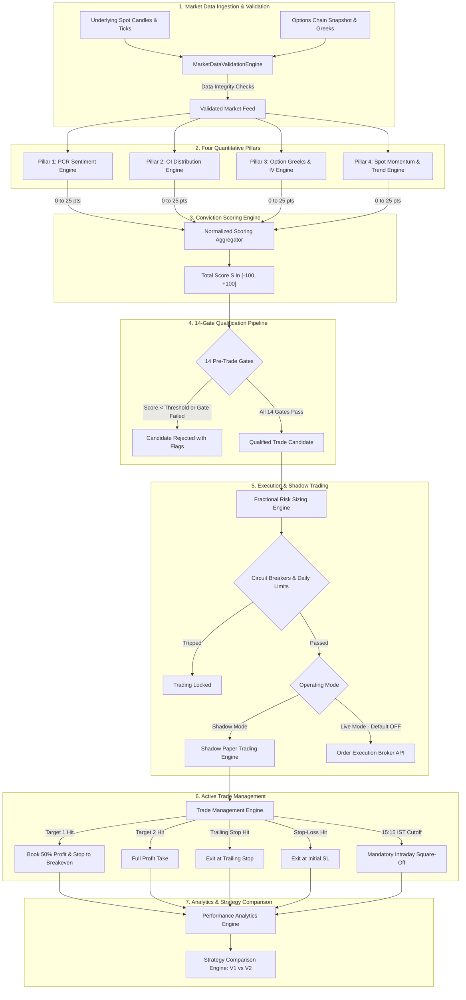
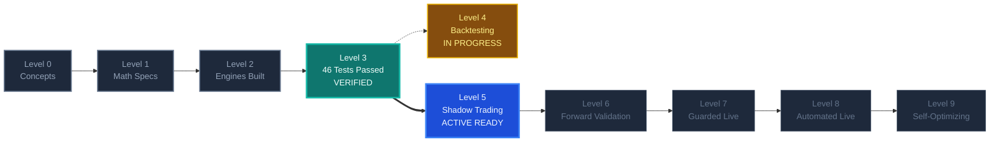

# AutoTrade FnO: NIFTY 50 & SENSEX Quantitative Trading Workstation

**AutoTrade FnO** is an institutional-grade, real-time algorithmic trading and quantitative analytics workstation engineered specifically for Indian Index Futures & Options (**NSE NIFTY 50** and **BSE SENSEX**).

Built on **.NET 10 (C#)**, **SignalR WebSockets**, and **React 19 + TypeScript + Tailwind CSS v4**, the workstation delivers real-time options chain depth, analytical European Black-Scholes Greeks, Put-Call Ratio (PCR) analytics, Max Pain strike calculation, strike-wise Open Interest (OI) buildup classification, and a 4-pillar quantitative conviction scoring engine. The interface is styled with the **OrderBlock Quantum Dark** design system featuring micro-animations across every element.

---

## Key Capabilities

### 1. Dual Index Support (NIFTY 50 & SENSEX)
- **Instant Index Switching**: Toggle seamlessly between **NSE NIFTY 50** (`NSE_INDEX|Nifty 50`, 50-point strike increments) and **BSE SENSEX** (`BSE_INDEX|SENSEX`, 100-point strike increments).
- **Automated Expiry Discovery**: Discovers all active weekly and monthly expiries directly from Upstox contracts metadata.
- **24/7 Simulator Fallback**: Automatically activates a tick simulator when testing after market hours or without active broker credentials.

### 2. Analytical Black-Scholes Greeks Engine
- **Internal European Analytical Engine**: Zero-latency calculation of Delta ($\Delta$), Gamma ($\Gamma$), Theta ($\Theta$ per day), Vega ($\nu$ per 1%), Rho ($\rho$), and Probability of Profit (POP).
- **High-Precision IV Solver**: Hybrid Newton-Raphson & Bisection Implied Volatility solver calibrated for Indian index options.
- **Dual-Source Architecture**: Uses live broker Greeks or falls back to the internal Black-Scholes engine when broker Greeks are unavailable.

### 3. Open Interest (OI), PCR & Buildup Analytics
- **Continuous PCR Sentiment**: Strike-wise OI PCR, Volume PCR, and At-The-Money (ATM) PCR.
- **Max Pain Theory**: Calculates the exact strike minimizing option sellers' total payout.
- **Buildup Classification**: Real-time tagging for every strike:
  - **LB**: Long Buildup (Price $\uparrow$, OI $\uparrow$) — Bullish accumulation
  - **SB**: Short Buildup (Price $\downarrow$, OI $\uparrow$) — Bearish writing
  - **SC**: Short Covering (Price $\uparrow$, OI $\downarrow$) — Short exit rally
  - **LU**: Long Unwinding (Price $\downarrow$, OI $\downarrow$) — Long exit liquidation
- **Key Liquidity Walls**: Identifies the Call Wall (Major Resistance) and Put Wall (Major Support).

### 4. 4-Pillar Quantitative Conviction Scoring (-100 to +100)
Combines market dynamics into an actionable confluence score:
1. **Pillar 1: PCR Sentiment Score (25 pts)**: Proportional continuous scoring anchored around the 1.00 baseline, coupled with intraday Volume PCR flow, ATM PCR, and PCR slope/velocity.
2. **Pillar 2: OI Distribution & Max Pain Gravity (25 pts)**: Net buildup dominance (LB + SC vs SB + LU), fresh call vs put writing flow, and distance gravity from Max Pain.
3. **Pillar 3: Option Greeks & IV Regime (25 pts)**: Decoupled evaluation of ATM Delta asymmetry micro-skew, IV regime vs trend momentum, Call vs Put volatility skew, and Gamma acceleration.
4. **Pillar 4: Spot Momentum & Trend (25 pts)**: EMA 9 / EMA 21 triad, Supertrend direction, and RSI-14 momentum bands.

High-conviction thresholds: $\ge +60$ for Bullish setups (**Buy ATM CE**) and $\le -60$ for Bearish setups (**Buy ATM PE**).

### 5. Tri-Mode Execution & Capital Protection
- **Manual Mode**: Visual cockpit with 1-click execution for Calls and Puts.
- **Semi-Auto Mode**: Evaluates setups continuously and displays modal alerts with pre-calculated lot sizes, entry prices, stop-losses, and profit targets.
- **Full-Auto Mode**: Automated bot execution with predefined risk guardrails.
- **Risk Management**: Enforces lot sizes (NIFTY: 25/75, SENSEX: 10/20), Max Daily Loss Limit (₹5,000 default), 03:15 PM IST auto square-off, and **Emergency Kill Switch**.

---

## OrderBlock Quantum Dark Design System

The workstation features a high-tech **OrderBlock Quantum Dark** aesthetic with reactive micro-animations:

- **Deep Void Canvas (`#06080C`)**: Frosted glassmorphism panels (`#0D1118`, `#11161F`, `#161C27`), 56px subtle quantum grid pattern, and ambient light blooms.
- **Neon Accents**: Bull (`#19E58C`), Bear (`#FF4D67`), Amber (`#FFB020`), Sky (`#45B8FF`), Teal (`#2DD4BF`), and Violet (`#7B7BFF`).
- **Continuous Radar Scanner Beams (`.ob-scanner-beam`)**: Sweeping holographic beams across all card headers.
- **Real-Time Liquidity Stream & Traveling Spark (`.ob-liq-line` + `.ob-liq-spark`)**: Dynamic order flow visualization in the PCR strip.
- **Pulsing At-The-Money (ATM) Highlight (`.ob-atm-row`)**: Continuous breathing highlight with glowing borders on the active ATM strike row.
- **Metallic Glint Shimmer Bars (`.ob-glint-bar`)**: 45-degree diagonal glare sweep across conviction progress bars and Greeks decay meters.
- **Breathing Conviction Card Halo (`.ob-glow-bull` / `.ob-glow-bear`)**: Perimeter halo adapting dynamically to conviction score thresholds.
- **Real-Time Spot Tick Flash (`.ob-flash-up` / `.ob-flash-down`)**: Flashes on spot prices and option strikes whenever ticks arrive via SignalR.
- **Sonar Pulse Dot (`.ob-sonar-dot`)**: Expanding radar ping indicators for WebSocket feed connectivity and broker authorization status.
- **TradingView Lightweight Charts (v5.2.1)**: Custom dark theme with neon candlesticks, EMA 9 (`#45B8FF`), and EMA 21 (`#FFB020`).

---

## Port & Isolation Architecture

Engineered to operate alongside `Auto_Trade_V1` with zero port collisions:

| Component | AutoTrade FnO (This Project) | Auto_Trade_V1 (Equities) | Status |
| :--- | :--- | :--- | :--- |
| **Backend API** | `http://localhost:5010` | `http://localhost:5000` | Isolated |
| **Backend HTTPS** | `https://localhost:5011` | `https://localhost:5001` | Isolated |
| **Frontend Web** | `http://localhost:5174` | `http://localhost:5173` | Isolated |
| **SignalR Hub** | `/hubs/trading` | `/tradingHub` | Isolated |
| **Database** | `AutoFnoDb` (LocalDB) | `AutoTradeDb` (LocalDB) | Isolated |

---

## Project Structure

```text
Auto_fno_V1/
├── backend/
│   ├── AutoFno.slnx
│   ├── AutoFno.Domain/          # Enums, Entities, DTOs & Models
│   ├── AutoFno.Application/     # Black-Scholes Greeks, PCR, Max Pain, Strategy Engine, Risk Manager
│   ├── AutoFno.Infrastructure/  # Upstox v2 Client, SignalR Hub, Dapper Repos, Background Services
│   └── AutoFno.Api/             # ASP.NET Core (.NET 10) Controllers, Swagger, Middlewares (Port 5010)
├── web/
│   └── auto-fno-web/            # React 19 + TypeScript + Vite + Tailwind CSS v4 Cockpit (Port 5174)
│       └── src/
│           ├── components/      # HeaderBar, OptionChainMatrix, StrategyConvictionCard, TradingViewChart, etc.
│           ├── styles/          # orderblock-animations.css (Quantum Dark keyframes & tokens)
│           └── services/        # SignalR & REST API services
├── database/
│   ├── Scripts/                 # 00_InitDatabase.sql (Tables, Stored Procedures, Seed Config)
│   ├── Tables/
│   └── StoredProcedures/
├── run-backend.ps1              # Launch .NET 10 API backend (Port 5010)
├── run-web.ps1                  # Launch React 19 web cockpit (Port 5174)
└── start-all.ps1                # One-click dual-launcher for backend + frontend
```

---

## Quickstart

### 1. Database Initialization (SQL Server LocalDB)
Ensure SQL Server LocalDB is running, then execute the initialization script:
```powershell
sqllocaldb start MSSQLLocalDB
sqlcmd -S "(localdb)\MSSQLLocalDB" -E -i "database\Scripts\00_InitDatabase.sql"
```

### 2. Configure Upstox Developer Credentials (Optional)
Edit `backend/AutoFno.Api/appsettings.json` with your Upstox credentials:
```json
{
  "Upstox": {
    "ApiKey": "YOUR_UPSTOX_API_KEY",
    "ApiSecret": "YOUR_UPSTOX_API_SECRET",
    "RedirectUri": "http://localhost:5010/api/upstoxauth/callback",
    "BaseUrl": "https://api.upstox.com/v2"
  }
}
```
*(If no credentials are provided or the market is closed, the platform automatically runs on its built-in realistic simulator).*

### 3. Launch Services

**Option A: One-Click Dual Launcher (Recommended)**
```powershell
.\start-all.ps1
```

**Option B: Individual Launchers**
- Backend:
  ```powershell
  .\run-backend.ps1
  ```
- Frontend:
  ```powershell
  .\run-web.ps1
  ```

### 4. Access URLs
- **Web Cockpit UI**: [http://localhost:5174](http://localhost:5174)
- **Swagger API Documentation**: [http://localhost:5010/swagger](http://localhost:5010/swagger)
- **SignalR Trading Hub**: `http://localhost:5010/hubs/trading`

---

## Trading Workflow

1. Open **[http://localhost:5174](http://localhost:5174)** in your browser.
2. Select **NIFTY 50** or **SENSEX** and choose the desired expiry from the dropdown.
3. Observe live spot ticks, ATM pulse glow, liquidity stream, option chain buildup badges, and Greeks.
4. When the 4-Pillar Quantitative Score reaches $\ge +60$ or $\le -60$, review the setup recommendation card.
5. In **Manual** or **Semi-Auto** mode, review strike, lot size, entry price, stop-loss, and target.
6. Verify and confirm the order via the confirmation modal.
7. Monitor open positions, live MTM P&L, or use **1-Click Square-Off** or the **Emergency Kill Switch** at any time.

---

## 13. Quantitative Conviction System V2.0

### A. Architecture Overview

The Quantitative Conviction Scoring System V2.0 operates alongside the legacy V1 system in total isolation. It synthesizes real-time market data across 4 quantitative pillars, normalizes them into a bounded score between $[-100, +100]$, validates candidate trades against a 14-point qualification pipeline, calculates fractional risk sizing, manages active trades with multi-target scaling, and tracks shadow paper trading metrics across score buckets.



### B. Mathematical Formulas

#### 1. Put-Call Ratio (PCR) Sentiment Score
The Put-Call Ratio reflects market participants' collective positioning:
$$PCR = \frac{\sum_{i=1}^n OI_{Put, i}}{\sum_{i=1}^n OI_{Call, i}}$$

The PCR Score $S_{PCR} \in [-25, +25]$ is computed based on level and slope:
$$S_{PCR, level} = \begin{cases}
+18 & \text{if } PCR \ge 1.3 \\
+12 & \text{if } 1.1 \le PCR < 1.3 \\
0 & \text{if } 0.9 \le PCR < 1.1 \\
-12 & \text{if } 0.7 \le PCR < 0.9 \\
-18 & \text{if } PCR < 0.7
\end{cases}$$

Incorporating rate-of-change $\Delta PCR = PCR_t - PCR_{t-1}$:
$$S_{PCR, slope} = \begin{cases}
+7 & \text{if } \Delta PCR > +0.05 \text{ (Bullish Expansion)} \\
-7 & \text{if } \Delta PCR < -0.05 \text{ (Bearish Liquidation)} \\
0 & \text{otherwise}
\end{cases}$$

$$S_{PCR} = \operatorname{clamp}(S_{PCR, level} + S_{PCR, slope}, -25, +25)$$

#### 2. Open Interest (OI) Distribution & Max Pain Score
Evaluates strike concentration, Call/Put walls, Max Pain distance, and institutional buildup:
$$S_{OI} = S_{buildup} + S_{maxpain} + S_{wall\_proximity}$$

Where buildup is classified via price and open interest change:
- **Long Buildup** ($\Delta Price > 0, \Delta OI > 0$): Bullish bias (+12 pts)
- **Short Covering** ($\Delta Price > 0, \Delta OI < 0$): Moderately bullish (+8 pts)
- **Short Buildup** ($\Delta Price < 0, \Delta OI > 0$): Bearish bias (-12 pts)
- **Long Unwinding** ($\Delta Price < 0, \Delta OI < 0$): Moderately bearish (-8 pts)

Max Pain pull factor:
$$S_{maxpain} = \operatorname{clamp}\left(\frac{\text{MaxPainStrike} - \text{SpotPrice}}{\text{StrikeStep}} \times 2.5, -7, +7\right)$$

$$S_{OI} = \operatorname{clamp}(S_{OI}, -25, +25)$$

#### 3. Option Greeks & Implied Volatility (IV) Score
Evaluates ATM IV percentile, IV skew ($\sigma_{Put} - \sigma_{Call}$), Delta directional leverage, and Vega risk:
$$S_{Greeks} = S_{Delta} + S_{Skew} + S_{IV\_Regime}$$

Option premium change is approximated using a second-order Taylor expansion:
$$\Delta C \approx \Delta \cdot \Delta S + \frac{1}{2} \Gamma \cdot (\Delta S)^2 + \Theta \cdot \Delta t + \nu \cdot \Delta \sigma$$

Scoring adjustments:
- Low IV ($\text{IV} < 13\%$, IV Percentile $< 30\%$): Ideal for net option buying ($+10 \text{ pts}$)
- High IV ($\text{IV} > 22\%$, IV Percentile $> 80\%$): Unfavorable for option buying due to IV crush risk ($-10 \text{ pts}$)
- Favorable Delta ($0.45 \le |\Delta| \le 0.55$): $+10 \text{ pts}$
- Theta decay drag penalty if $DTE \le 1$: $-5 \text{ pts}$

$$S_{Greeks} = \operatorname{clamp}(S_{Greeks}, -25, +25)$$

#### 4. Spot Momentum & Trend Score
Combines EMA alignment (9 EMA vs 21 EMA), Supertrend direction, RSI momentum, and VWAP positioning:
$$S_{Trend} = S_{EMA} + S_{Supertrend} + S_{RSI} + S_{VWAP}$$

- **EMA Trend**: $Spot > EMA_9 > EMA_{21} \implies +7 \text{ pts}$; $Spot < EMA_9 < EMA_{21} \implies -7 \text{ pts}$
- **Supertrend**: Bullish state $\implies +7 \text{ pts}$; Bearish state $\implies -7 \text{ pts}$
- **RSI Momentum**: $55 \le RSI \le 68 \implies +6 \text{ pts}$; $32 \le RSI \le 45 \implies -6 \text{ pts}$; $RSI > 75$ or $RSI < 25 \implies 0 \text{ pts}$ (overextended)
- **VWAP Bias**: $Spot > VWAP + 0.1 \times ATR \implies +5 \text{ pts}$; $Spot < VWAP - 0.1 \times ATR \implies -5 \text{ pts}$

$$S_{Trend} = \operatorname{clamp}(S_{Trend}, -25, +25)$$

#### 5. Total Normalized Conviction Score
$$S_{Total} = w_1 S_{PCR} + w_2 S_{OI} + w_3 S_{Greeks} + w_4 S_{Trend}$$
With normalized weights $w_1 = w_2 = w_3 = w_4 = 1.0$, resulting in:
$$S_{Total} = \operatorname{clamp}(S_{PCR} + S_{OI} + S_{Greeks} + S_{Trend}, -100, +100)$$

Decision Thresholds:
- $S_{Total} \ge +60$: Valid Bullish Candidate (`BuyAtmCeCandidate`)
- $S_{Total} \le -60$: Valid Bearish Candidate (`BuyAtmPeCandidate`)
- $-60 < S_{Total} < +60$: Neutral / No Trade (`NeutralNoTrade`)

#### 6. Realistic Friction & Slippage Model
Net P&L accounts for exchange turnover charges, SEBI turnover fees, STT (on sell turnover for options), GST (18% on brokerage + transaction charges), stamp duty, and real-world execution slippage:
$$\text{Cost}_{Brokerage} = 2 \times ₹20 = ₹40 \text{ per completed trade}$$
$$\text{Cost}_{Turnover} = 0.00053 \times \text{PremiumTurnover}_{Total}$$
$$\text{Cost}_{STT} = 0.001 \times \text{PremiumTurnover}_{Exit}$$
$$\text{Cost}_{GST} = 0.18 \times (\text{Cost}_{Brokerage} + \text{Cost}_{Turnover})$$
$$\text{Cost}_{Stamp} = 0.00003 \times \text{PremiumTurnover}_{Entry}$$
$$\text{Cost}_{Slippage} = 0.0025 \times \text{ExitPrice} \times \text{Quantity}$$
$$\text{Net P\&L} = \text{Gross P\&L} - (\text{Cost}_{Brokerage} + \text{Cost}_{Turnover} + \text{Cost}_{STT} + \text{Cost}_{GST} + \text{Cost}_{Stamp} + \text{Cost}_{Slippage})$$

#### 7. Net Mathematical Expectancy
$$E = (W \times \bar{R}_w) - (L \times \bar{R}_l) - C_{avg}$$
Where:
- $W$: Win rate percentage ($0.0$ to $1.0$)
- $\bar{R}_w$: Average profit on winning trades (in points or currency)
- $L$: Loss rate percentage ($1.0 - W$)
- $\bar{R}_l$: Average loss on losing trades (in points or currency)
- $C_{avg}$: Average total friction and slippage cost per trade

#### 8. Fractional Risk & Position Sizing
Position sizing is dynamically determined based on account equity, risk percentage, and distance to stop-loss:
$$\text{MaxRiskAmount} = \text{AccountCapital} \times \text{FractionalRiskRate}$$
$$\text{RiskPerUnit} = \operatorname{max}(\text{EntryPrice} - \text{StopLossPrice}, \text{MinimumRiskFloor})$$
$$\text{RawQuantity} = \left\lfloor \frac{\text{MaxRiskAmount}}{\text{RiskPerUnit}} \right\rfloor$$
$$\text{LotSizeAdjustedQuantity} = \max\left(1, \left\lfloor \frac{\text{RawQuantity}}{\text{LotSize}} \right\rfloor\right) \times \text{LotSize}$$

A conviction scaling factor further scales quantity between 1.0x (score = 60) and 1.5x (score $\ge 90$):
$$\text{FinalQuantity} = \operatorname{min}\left(\text{LotSizeAdjustedQuantity} \times \left(1.0 + \frac{|S_{Total}| - 60}{60}\right), \text{MaxAllowedLots} \times \text{LotSize}\right)$$

### C. Pillar Scoring Details

| Pillar | Sub-Engine | Min Pts | Max Pts | Weight | Primary Factor Evaluated |
| :--- | :--- | :---: | :---: | :---: | :--- |
| **Pillar 1** | PCR Sentiment | -25 | +25 | 25% | Put/Call OI ratio level, OI rate of change ($\Delta PCR$) |
| **Pillar 2** | OI Distribution | -25 | +25 | 25% | Strike buildup classification, Call/Put wall proximity, Max Pain delta |
| **Pillar 3** | Option Greeks & IV | -25 | +25 | 25% | Delta leverage ($0.45$-$0.55$), IV Percentile regime, Skew, Theta decay drag |
| **Pillar 4** | Spot Trend & Momentum | -25 | +25 | 25% | 9/21 EMA spread, Supertrend band, RSI ($55$-$68$ / $32$-$45$), VWAP separation |
| **Total** | **Combined Conviction** | **-100** | **+100** | **100%** | **Comprehensive Multi-Factor Conviction Engine** |

### D. Pre-Trade Qualification Gates

Every potential setup must pass all 14 independent pre-trade gates before being approved as a candidate:

| # | Qualification Gate | Threshold / Condition | Rejection Flag Enum | Description |
| :-: | :--- | :--- | :--- | :--- |
| 1 | **Minimum Conviction Score** | $|S_{Total}| \ge 60$ | `ConvictionScoreTooLow` | Ensures setup has statistically significant directional edge |
| 2 | **Pillar Alignment Minimum** | $\ge 3$ of 4 pillars agree | `PillarAlignmentFailed` | Prevents trades when underlying factors conflict |
| 3 | **Option Bid-Ask Spread** | Spread $\le 1.5\%$ of LTP | `WideBidAskSpread` | Protects from excessive execution slippage |
| 4 | **Minimum Contract Open Interest**| Contract OI $\ge 50,000$ contracts | `LowContractLiquidity` | Ensures deep institutional liquidity for fills |
| 5 | **Minimum Contract Daily Volume** | Contract Volume $\ge 10,000$ | `LowVolume` | Verifies active order flow and real-time turnover |
| 6 | **Time-to-Expiry Window** | $\ge 2$ hours to expiry | `ExpiryImminent` | Eliminates gamma pin risk and accelerated theta decay |
| 7 | **IV Crush Protection** | IV Percentile $\le 85\%$ | `IvCrushRisk` | Prevents buying options during post-event IV collapse |
| 8 | **Major Event Proximity** | No RBI/Union Budget event within 1 hr | `EventRiskImminent` | Protects against binary event volatility spikes |
| 9 | **Risk-Reward Minimum** | Projected R:R $\ge 1:1.5$ | `UnfavorableRiskReward` | Ensures favorable mathematical expectancy |
| 10 | **Consolidation / Choppiness** | ATR-normalized band $\ge 0.25\%$ | `MarketChoppinessDetected`| Rejects trades during directionless, low-volatility churn |
| 11 | **Daily Loss Limit** | Cumulative Day Loss $<$ Daily Limit | `DailyLossLimitReached` | Hard stop preserving trading capital |
| 12 | **Consecutive Loss Circuit** | Consecutive losses $< 3$ in session | `ConsecutiveLossLimitReached`| Cools down strategy after cluster drawdowns |
| 13 | **Duplicate Signal Cooldown** | $\ge 15$ mins since last trade on symbol | `DuplicateSignalCooldown` | Prevents overtrading the same directional impulse |
| 14 | **Trading Session Time Window** | 09:20 IST $\le \text{Time} \le$ 15:00 IST | `OutsideTradingHours` | Avoids opening noise and closing auction volatility |

### E. Risk Management Parameters

| Parameter Name | Default Value | Allowed Range | Description |
| :--- | :---: | :---: | :--- |
| `EnableV2` | `false` | `true / false` | Master enable toggle for V2 Quantitative Conviction engine |
| `V2ShadowMode` | `false` | `true / false` | Shadow paper trading mode; evaluates and tracks without live orders |
| `V2LiveTrading` | `false` | `true / false` | Live order routing via broker APIs; strictly default false |
| `MaxCapitalAllocationPercent` | `20.0%` | $5.0\% - 40.0\%$ | Maximum total capital allocated to any single V2 position |
| `RiskPerTradePercent` | `1.5%` | $0.5\% - 3.0\%$ | Maximum portfolio risk per single trade setup |
| `MinConvictionThreshold` | `60.0` | $50.0 - 85.0$ | Minimum conviction score required to qualify candidate |
| `MaxDailyLossLimit` | `₹10,000` | $₹2,000 - ₹100,000$ | Account-wide daily loss ceiling triggering full halt |
| `MaxConsecutiveLosses` | `3` | $2 - 5$ | Consecutive loss count triggering automatic trading lockout |
| `CoolDownMinutes` | `15` | $5 - 60$ | Mandatory cooldown between consecutive trades on same symbol |
| `Target1PartialExitPercent` | `50.0%` | $30.0\% - 70.0\%$ | Position percentage closed upon reaching Target 1 (+1R) |
| `MinContractOi` | `50,000` | $10,000 - 200,000$ | Minimum strike open interest required for trade entry |
| `MaxBidAskSpreadPercent` | `1.5%` | $0.5\% - 3.0\%$ | Maximum permissible contract bid-ask spread |

### F. Active Trade Management Rules

1. **Initial Stop-Loss**: Computed at Entry Price minus $1.0 \times \text{Risk Distance}$ (or local swing low/high).
2. **Target 1 (+1.0R Partial Exit)**:
   - When contract LTP reaches $+1.0 \times \text{Risk Distance}$, automatically close **50% of position size**.
   - Immediately shift stop-loss on remaining lots to **Breakeven (Entry Price)**.
3. **Trailing Stop-Loss (+1.5R)**:
   - When contract LTP crosses $+1.5 \times \text{Risk Distance}$, trail stop-loss dynamically at $0.5 \times \text{Risk Distance}$ below highest price reached.
4. **Target 2 (+2.0R to +3.0R Final Exit)**:
   - Close remaining 50% lots upon reaching Target 2 or when trailing stop triggers.
5. **Intraday Mandatory Cutoff**:
   - At **15:15 IST**, all open intraday positions are closed unconditionally at market price.

### G. Shadow Paper Trading Engine

The Shadow Paper Trading engine tracks hypothetical trade candidates in real-time without risking real capital:
- **Zero Live Impact**: Operates completely in-memory alongside the market feed.
- **Score Bucket Stratification**: Hypothetical trades are segmented into 5 conviction tiers:
  - Tier 1: $50 \le |S| < 60$ (Near-threshold)
  - Tier 2: $60 \le |S| < 70$ (Moderate conviction)
  - Tier 3: $70 \le |S| < 80$ (High conviction)
  - Tier 4: $80 \le |S| < 90$ (Very high conviction)
  - Tier 5: $90 \le |S| \le 100$ (Extreme conviction)
- **Excursion Tracking**: Measures Maximum Adverse Excursion (MAE) and Maximum Favorable Excursion (MFE) for every trade.
- **Net Expectancy Calculation**: Computes real-world profitability after deducting brokerage, turnover charges, STT, GST, stamp duty, and slippage.

### H. Strategy Comparison Engine (V1 vs V2)

The `StrategyComparisonEngine` provides side-by-side performance benchmarking:

| Benchmark Metric | V1 Legacy Strategy | V2 Quantitative Conviction | Advantage / Difference |
| :--- | :---: | :---: | :--- |
| **Pillar Evaluation** | 1 (Single indicator) | 4 Integrated Pillars | Multi-dimensional confirmation |
| **Pre-Trade Gates** | Basic filters | 14 Specialized Gates | Eliminates low-liquidity and event churn |
| **Position Sizing** | Fixed lot count | Dynamic Fractional Sizing | Risk-adjusted capital allocation |
| **Trade Scaling** | Single exit | 50% at +1R, Breakeven, Runner | Locks in gains early while capturing trends |
| **Cost Modeling** | Gross MTM | Realistic Net Friction (inc. slippage) | Reflects true cash balance change |
| **Drawdown Circuit** | Manual intervention | Automated 3-Loss & Daily Cap | Preserves trading capital algorithmically |

Sample JSON comparison output format:
```json
{
  "timestamp": "2026-10-30T10:30:00Z",
  "v1Metrics": {
    "totalTrades": 42,
    "winRatePercent": 47.6,
    "profitFactor": 1.15,
    "netPnl": 4250.00
  },
  "v2ShadowMetrics": {
    "totalTrades": 28,
    "winRatePercent": 64.3,
    "profitFactor": 2.18,
    "netPnl": 18450.00,
    "netExpectancyPerTrade": 658.93,
    "averageMae": 8.4,
    "averageMfe": 26.2
  },
  "delta": {
    "winRateImprovementPercent": 16.7,
    "profitFactorDelta": 1.03,
    "netPnlImprovement": 14200.00
  }
}
```

### I. API Endpoints

All V2 Quantitative Conviction endpoints are grouped under `/api/v2/conviction`:

| HTTP Method | Route | Description | Expected Request / Response |
| :--- | :--- | :--- | :--- |
| `GET` | `/api/v2/conviction/score` | Calculates live 4-pillar conviction score | Query params: `symbol`, `expiry` $\to$ Returns `V2ConvictionScoreDto` |
| `GET` | `/api/v2/conviction/candidate` | Evaluates trade qualification gates | Query params: `symbol`, `expiry` $\to$ Returns `V2TradeCandidate` |
| `GET` | `/api/v2/conviction/shadow/performance` | Retrieves shadow paper trading metrics | Query param: `symbol` (optional) $\to$ Returns `V2PerformanceMetricsDto` |
| `GET` | `/api/v2/conviction/compare` | Returns side-by-side V1 vs V2 stats | Query param: `symbol` (optional) $\to$ Returns `V1VsV2ComparisonDto` |
| `GET` | `/api/v2/conviction/config` | Returns current V2 configuration | Returns `QuantitativeConvictionV2Config` |
| `POST`| `/api/v2/conviction/config` | Updates V2 configuration safely | Body: `QuantitativeConvictionV2Config` $\to$ Returns updated config |

### J. Configuration Reference

```json
{
  "QuantitativeConvictionV2": {
    "EnableV2": false,
    "V2ShadowMode": false,
    "V2LiveTrading": false,
    "AccountCapital": 100000.0,
    "MaxCapitalAllocationPercent": 20.0,
    "RiskPerTradePercent": 1.5,
    "MinConvictionThreshold": 60.0,
    "MaxDailyLossLimit": 10000.0,
    "MaxConsecutiveLosses": 3,
    "CoolDownMinutes": 15,
    "Target1PartialExitPercent": 50.0,
    "MinContractOi": 50000,
    "MaxBidAskSpreadPercent": 1.5,
    "FrictionModel": {
      "BrokeragePerTrade": 40.0,
      "ExchangeTurnoverRate": 0.00053,
      "SttRate": 0.001,
      "GstRate": 0.18,
      "StampDutyRate": 0.00003,
      "SlippagePercent": 0.25
    }
  }
}
```

### K. Safety Guarantees

1. **V1 Non-Destructive Operation**: All existing V1 components (`FnOStrategyExecutionBackgroundService`, `StrategyRecommendationHub`, UI Cockpit) remain fully intact and operational.
2. **Default-Disabled Guardrails**: `EnableV2 = false`, `V2ShadowMode = false`, and `V2LiveTrading = false` by default in configuration.
3. **Complete Exception Isolation**: Any unexpected condition inside V2 engines is caught and logged within dedicated `try/catch` boundaries, preventing any impact on the live V1 execution loop.
4. **Duplicate Signal Cooldown**: Enforces a 15-minute freeze window after any candidate evaluation on a given underlying.
5. **Circuit Breakers**: Immediate automatic trading lockout upon reaching 3 consecutive losing trades or exceeding the ₹10,000 maximum daily loss limit.

---

## 14. Current System Maturity and Development Progress

### System Maturity Framework (Levels 0 to 9)

| Level | Maturity Stage | Status | Description | Verification Evidence |
| :---: | :--- | :---: | :--- | :--- |
| **0** | **Conceptual Architecture** | **Completed** | Definition of 4-pillar conviction model, 14 qualification gates, dynamic risk sizing, and shadow tracking. | Master implementation plan and architecture documentation. |
| **1** | **Mathematical Specification** | **Completed** | Full formulation of PCR sentiment, OI buildup, Greeks Taylor expansion, Supertrend/EMA momentum, and friction modeling. | Formulas documented and implemented in domain models and interfaces. |
| **2** | **Engine Implementation** | **Completed** | Complete C# implementation of all 11 quantitative engines, DTOs, domain enums, DI wiring, and background coordination. | `AutoFno.Application/V2` and `AutoFno.Infrastructure/V2` compilable with 0 errors. |
| **3** | **Unit & Integration Testing** | **Completed** | 6 test suites covering 46 test cases across all 22 master scenarios including boundary tests and random fuzzing. | `dotnet test AutoFno.Tests.csproj` passes **46 / 46 (100%)** in 108ms. |
| **4** | **Historical Backtesting** | **In Progress** | Validation of 4-pillar conviction thresholds against multi-month historical tick and candle archives. | Offline dataset collection and replay harness under construction. |
| **5** | **Shadow Paper Trading** | **Active (Ready)**| Real-time shadow forward evaluation alongside live market feed with score bucket and MAE/MFE tracking. | `/api/v2/conviction/shadow/performance` endpoint and coordinator wired. |
| **6** | **Forward Validation** | **Planned** | Out-of-sample forward testing across trending, range-bound, and high-volatility expiry regimes (min 30 trading days). | Scheduled following shadow paper trading data accumulation. |
| **7** | **Guarded Live Trading** | **Planned** | Micro-lot live execution (1 lot NIFTY) with strict capital caps, manual confirmation, and emergency kill switches. | Requires manual toggle of `V2LiveTrading = true`. |
| **8** | **Fully Automated Live Trading** | **Planned** | Production algorithmic trade execution with automated multi-target scaling, trailing stops, and daily circuit breakers. | Subject to successful guarded live performance evaluation. |
| **9** | **Self-Optimizing System** | **Planned** | Dynamic machine-learning weight optimization ($w_1, w_2, w_3, w_4$) and adaptive regime threshold adjustments. | Future milestone roadmap. |

### Current Verified Status

- **Highest Formally Verified Level**: **Level 3 (Unit & Integration Testing)** — Fully verified via 46 comprehensive automated test cases with 100% pass rate.
- **Active Operational Capability**: **Level 5 (Shadow Paper Trading)** — Built, wired into the background market stream, and ready for activation via configuration without risking capital.

### Progression Flowchart



### Next Advancement Requirements
To advance from **Level 3 & 5** to **Level 6 (Forward Validation)**:
1. Accumulate a minimum of 100 shadow paper trades across diverse volatility regimes (low IV, expiry gamma, RBI policy announcements).
2. Verify positive mathematical net expectancy ($E > 0$) after full friction deductions across all score buckets $\ge 60$.
3. Validate that the 14 qualification gates successfully filter out false breakouts during choppy rangebound sessions.

